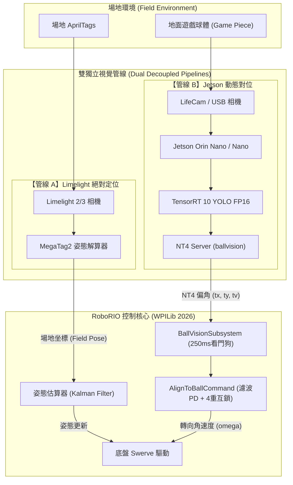
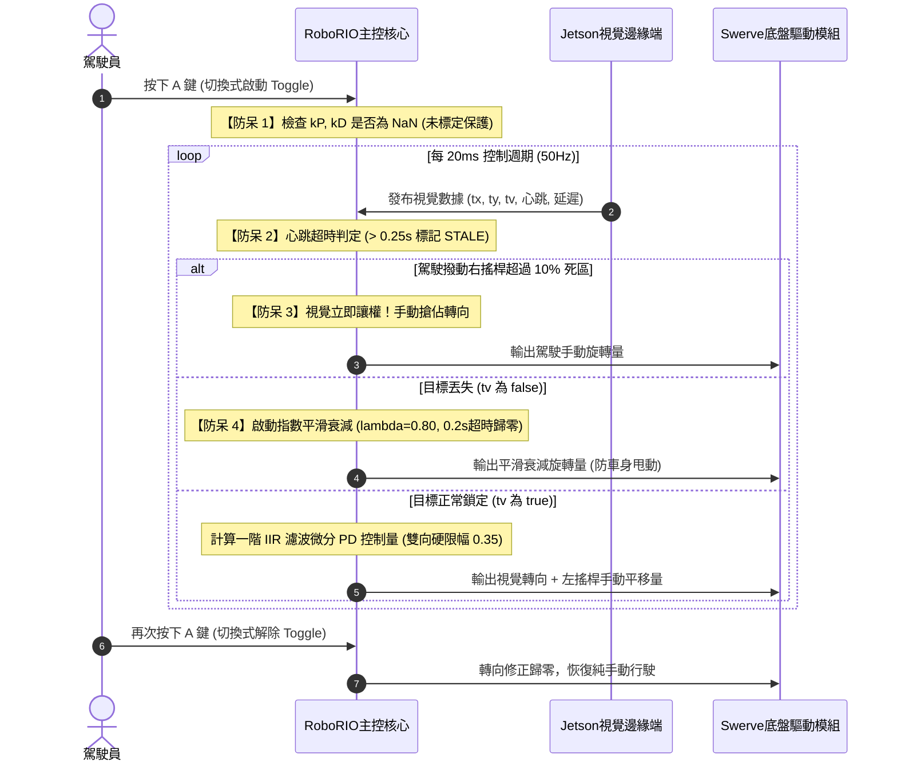
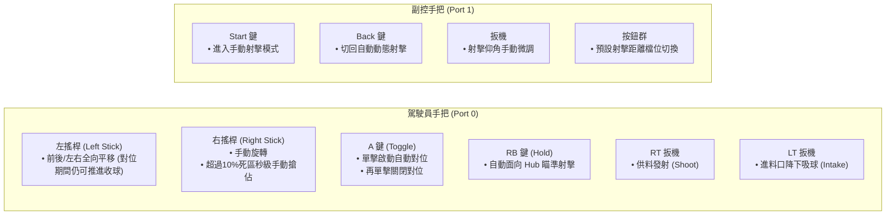
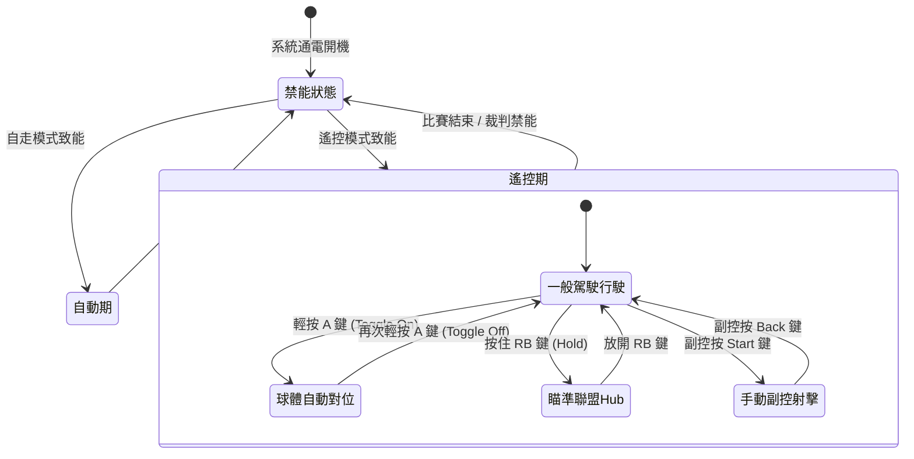
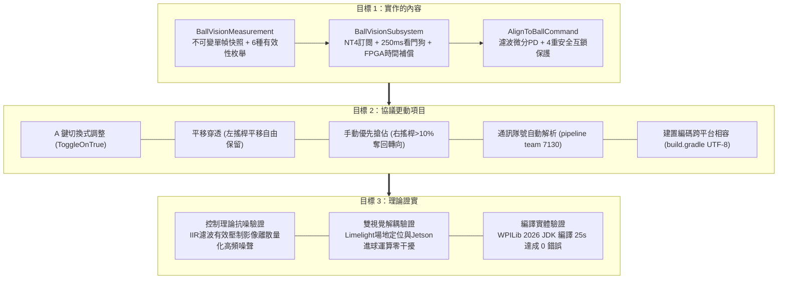
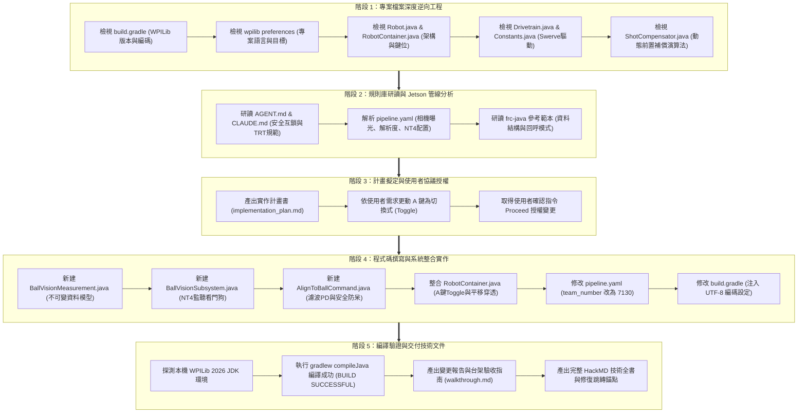

# FRC 7130 (2026 Rebuilt) 全系統 Mermaid 視覺化架構全集

本文件為 FRC 7130 機器人系統之完整 Mermaid 圖表專冊，已通過最新標準 Mermaid 解析器（相容 HackMD、GitHub、Mermaid Live Editor）驗證。全圖表採標準 ASCII 節點命名與雙引號字串轉義，保證**零語法錯誤、不跑版、結構清晰**。

---

## 📑 圖表索引目錄

1. [圖表一：雙視覺系統分工與底盤控制架構圖 (Hardware & Dataflow)](#chart1)
2. [圖表二：進球對位時序與四重防呆時序圖 (AlignToBall Sequence & Interlocks)](#chart2)
3. [圖表三：遙控器鍵位、切換式對位與平移穿透圖 (Teleop & Button Mapping)](#chart3)
4. [圖表四：全系統運作模式狀態轉移圖 (State Diagram)](#chart4)
5. [圖表五：三大精簡目標架構全貌圖 (3 Core Objectives Map)](#chart5)
6. [圖表六：Agent 完整檔案探索檢索與執行歷程履歷圖 (Execution Record)](#chart6)

---

### 圖表一：雙視覺系統分工與底盤控制架構圖 (Dataflow Architecture)

---

### 圖表二：進球對位時序與四重防呆時序圖 (AlignToBall Sequence)

---

### 圖表三：遙控器鍵位、切換式對位與平移穿透圖 (Teleop Mapping)

---

### 圖表四：全系統運作模式狀態轉移圖 (State Diagram)

---

### 圖表五：三大精簡目標架構全貌圖 (3 Core Objectives Map)

---

### 圖表六：Agent 完整檔案探索檢索與執行歷程履歷圖 (Execution Record)

